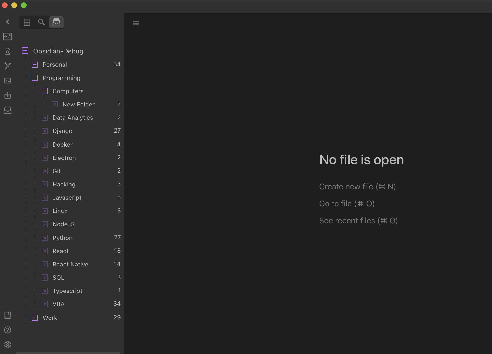
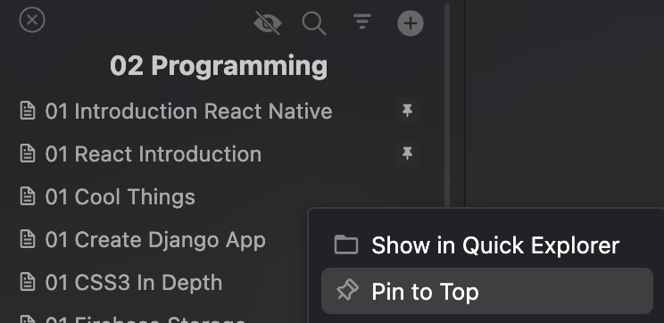
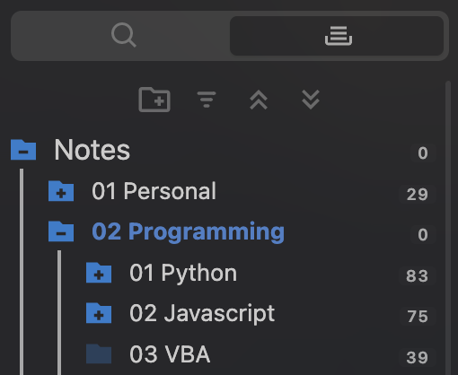
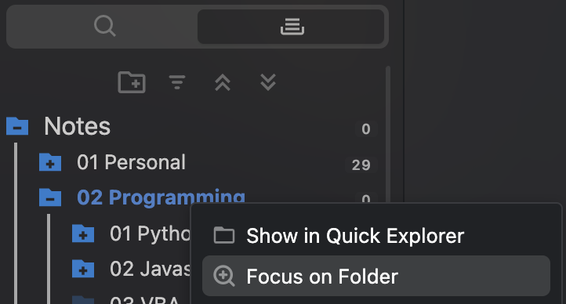
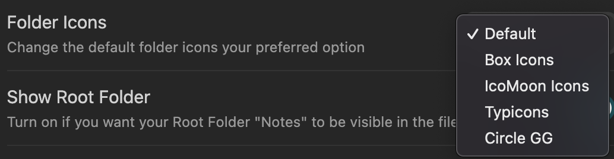
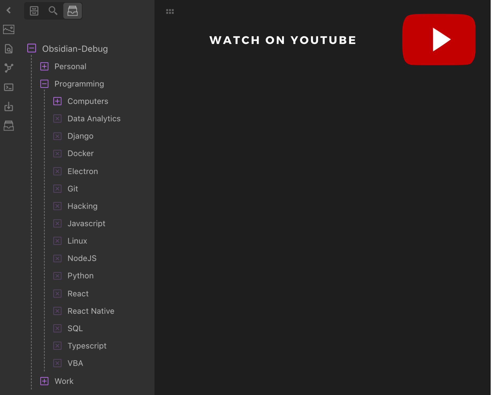

# File Tree Alternative for Obsidian

**An Evernote-style file explorer for Obsidian: folders on one side, your notes on the other, with previews, powerful search, pinning and multi-select. Works on desktop and mobile.**

The default Obsidian explorer puts every folder and every file into one long tree. In a large vault, that quickly becomes hard to scan. File Tree Alternative splits the view in two: pick a folder and see its notes in a clean list, with a preview of what is inside each one.

## ✨ Top Features

-   **Two-pane layout:** folders and notes side by side (or stacked), like Evernote or Apple Notes. Drag the divider to resize.
-   **Note previews:** see the first lines of every note, its date, tags, aliases, a frontmatter property of your choice and the first image, right in the list.
-   **Powerful search:** filter by name with AND, OR, NOT and fuzzy matching, search by tag, or search the whole vault.
-   **Pin to top:** keep your most important notes at the top of every list.
-   **Multi-select:** select many notes at once to move, pin or delete them, with the mouse, the keyboard or by touch.
-   **Focus on a folder:** double-click a folder to zoom into it and hide everything else.
-   **Made for mobile too:** long-press menus, touch-friendly selection, resizable panes and an optional larger layout for easier tapping.
-   **Folder notes, note counts, custom icons, sorting and more,** all configurable in the settings.

## 🚀 Getting Started

1. Open **Settings → Community plugins → Browse**, search for **File Tree Alternative** and install it.
2. Enable the plugin. The file tree opens in the left sidebar automatically.
3. Choose a layout in the plugin settings under **Evernote View**:
    - **Vertical:** folders on top, notes below (default)
    - **Horizontal:** folders on the left, notes on the right
    - **Disabled:** a single pane that switches between the folder view and the file list

If you close the view by accident, bring it back with the ribbon icon or the **Open File Tree View** command.

## 📝 File List & Note Previews

The file list shows the notes of the selected folder. By default, it also includes notes from all of its subfolders; turn this off in the settings or use the 👁 button above the list to switch.

Choose how the list looks with **File List Style**:

-   **Preview:** every note shows its title, the first lines of text, the date and extra details. Notes that only contain frontmatter or an image stay compact.
-   **Compact:** only the file names, for maximum density.

In **Preview** style, you can choose:

| Option               | What it does                                                                                      |
| -------------------- | ------------------------------------------------------------------------------------------------- |
| Preview Lines        | Show 1, 2 or 3 lines of text per note                                                             |
| Preview Thumbnails   | Show the first image of a note (or the image file itself) as a thumbnail                          |
| Preview Tags         | Show the tags of a note                                                                           |
| Preview Aliases      | Show the aliases of a note (orange chips)                                                         |
| Preview Property     | Show the value of any frontmatter property next to the date, e.g. `status` or `author` (blue chip) |

The date follows your sorting: it shows the creation date when you sort by **Creation Time**, and the last modified date otherwise. Previews update as soon as you edit a note.

**More in the file list:**

-   **Sorting:** by name, file size, creation time or update time, in either direction.
-   **Pin to top:** right-click a note and choose **Pin to Top**. Pinned notes stay at the top and are remembered between sessions.
-   **Drop files from your computer** onto the list to add them to the current folder.
-   **Drag notes** into the editor to insert a link, or onto a folder to move them.
-   **Preview on hover:** hold Ctrl/Cmd while hovering a note to see a popup preview (enable **Preview File on Hover** in the settings).
-   **Reveal active file:** jump to the folder of the note you are editing with the **Reveal Active File** command, or turn on the 🎯 button above the list in the settings.

## 🔍 Search

Click the 🔍 button above the file list (you can hide it with **Search in File List** in the settings). Search filters the notes of the current folder by name, and you can combine terms:

| You type            | It finds                                                  |
| ------------------- | --------------------------------------------------------- |
| `meeting notes`     | Names containing both "meeting" **and** "notes"           |
| `meeting \| call`   | Names containing "meeting" **or** "call" (`OR` also works) |
| `meeting -draft`    | "meeting" but **not** "draft"                             |
| `~mtng`             | **Fuzzy** match: the letters in order, with gaps allowed  |
| `"weekly review"`   | The exact phrase                                          |
| `all: budget`       | "budget" in the **whole vault**, not only this folder     |
| `tag: project`      | Notes with a tag that matches "project" (including YAML tags) |

Press **Escape** to close the search box.

## ☑️ Multi-Select

Select several notes and act on all of them at once.

-   **Desktop:** Ctrl/Cmd + click to add or remove a note, Shift + click to select a range.
-   **Mobile (and desktop):** long-press (or right-click) a note and choose **Select**, then tap notes to add or remove them.

While selecting, each note shows a checkbox, the header shows how many notes are selected with **Select all** and **Done**, and a bar at the bottom lets you **Move**, **Pin/Unpin** or **Delete** the selection. Press **Escape** or **Done** to finish.

## 📁 Folder Pane

-   **Note counts** next to every folder: count only notes or all files, or hide the counts.
-   **Focus on a folder:** double-click a folder (or use **Focus on Folder** in its menu) to show only that folder and its subfolders. Double-click it again to go up one level.
-   **Expand or collapse all** folders with the buttons at the top.
-   **Sort folders** by name or by number of items.
-   **Custom folder icons:** choose from several icon sets in the settings.
-   **Drag and drop** folders into other folders to move them.
-   The plugin **remembers** which folders were open and which folder was focused, so everything looks the same next time you open your vault.

Right-click (or long-press) a folder for more: New File, New Folder, Rename, Move, Delete, Focus and **Add to Excluded Folders**.

    
    
    

### Folder Notes

Turn on **Folder Note** to give every folder its own note (stored inside the folder with the same name). Shift + click a folder to open its note. Folders that have a note show a small arrow, and the folder note itself is hidden from the file list. Create or delete folder notes from the folder menu.

## 📱 Mobile

The plugin is designed to work well on phones and tablets:

-   **Long-press** a note or folder to open its menu.
-   **Select** in the note menu starts multi-select, so you can move, pin or delete several notes with your thumb.
-   Opening a note **closes the sidebar** automatically, just like the built-in explorer.
-   **Drag the divider** between the folder and note panes to resize them.
-   Turn on **Larger Touch Targets on Mobile** for taller rows, bigger text and more space between buttons. Leave it off to fit more notes on the screen.

## ⚙️ More Options

-   **Hide files you don't need:** exclude folders (all of their subfolders are excluded too) or file extensions such as `png, pdf`, or hide your attachments folder.
-   **New notes:** optionally add a `created` date to the frontmatter and the file name as the first heading when you create a note with the ➕ button.
-   **Deleted files** can go to the Obsidian trash, the system trash or be deleted permanently.
-   **Show file names as full path**, **show or hide the root folder**, **file icons** before names and a **fixed header** that stays visible while scrolling.
-   **Bookmarks integration:** Shift + click a file or folder in Obsidian's Bookmarks to reveal it in the file tree.

### Customize the Look

Install the [Style Settings](https://github.com/mgmeyers/obsidian-style-settings) plugin to change font sizes and colors of the folder pane, file list, headers and active items without writing CSS.

## ⌨️ Shortcuts & Commands

| Action                          | How                                                    |
| ------------------------------- | ------------------------------------------------------ |
| Open a note in a new tab        | Middle-click, or **Open in a new tab** in the menu     |
| Open a note to the right        | **Open to right** in the menu                          |
| Select multiple notes           | Ctrl/Cmd + click, Shift + click, or **Select** in the menu |
| Focus on a folder / go up       | Double-click the folder                                |
| Open a folder note              | Shift + click the folder                               |
| Clear the selection             | Escape                                                 |

Commands you can assign a hotkey to (Settings → Hotkeys):

-   **Open File Tree View**
-   **Reveal Active File**
-   **Create a New Note** in the current folder

## 📺 Video

Antone Heyward also made a great walkthrough: [Enhance The File Explorer File Tree Alternative Plugin](https://youtu.be/KBzE_BT0rtQ).

## 📰 What's New

The plugin is updated regularly. See [Release Updates](https://github.com/ozntel/file-tree-alternative/blob/main/Releases.md) for the changes in every version.

## 💬 Feedback & Contact

Found a bug or have an idea? [Open an issue on GitHub](https://github.com/ozntel/file-tree-alternative/issues), use the contact page on [ozan.pl/contact](https://www.ozan.pl/contact/), or email <me@ozan.pl>.

## ☕ Support

If the plugin makes your Obsidian life easier, you can support its development by buying me a coffee:

